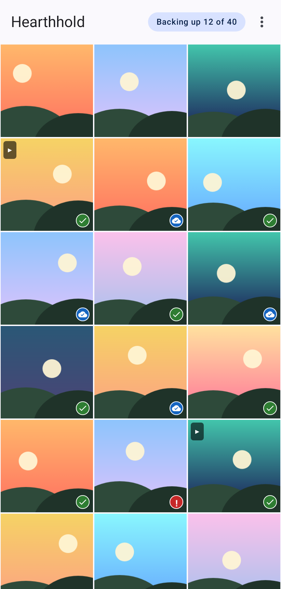
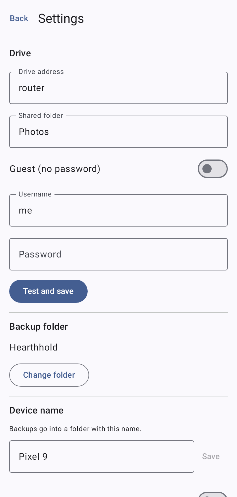

<p align="center">
  
</p>

<h1 align="center">Hearthhold</h1>

<p align="center">
  Back up your phone's photos and videos to the drive plugged into your home router.<br>
  No cloud, no accounts: your pictures stay in your house.
</p>

<p align="center">
  <a href="../../releases/latest"></a>
  
  
</p>

<p align="center">
  
  
  
</p>
<p align="center"><sub>Screenshots use made-up demo data.</sub></p>

## Features

- **Automatic backup** of Camera, Screenshots and any folders you pick, over SMB2/3 on home Wi-Fi.
- **Verified copies**: every file is read back and checked with SHA-256 before it counts as backed up. Nothing on the drive is ever overwritten.
- **Free up space**: suggests old, big items; re-checks both copies by hash, then Android asks you to confirm the delete.
- **Swipe review and Bin**: go through photos one at a time: Up keep, Right drive only, Left junk, Down skip (gestures configurable), with Undo. Nothing changes until Finish; junk drive copies go to a `.Bin` folder on the drive, where you can restore or empty them.
- **Gallery** of phone and drive together, with a badge on each item showing where it lives.
- **Viewer and player** for photos and videos, from the phone or straight from the drive, with loop and 0.25x–2x speed.
- **Gentle on your router**: one file at a time by default, adjustable parallel uploads, optional overnight-only window.
- **Organised drive**: `Device/Source folder/Year/`, with file dates set to when the photo was taken.
- **Named folders**: send a phone folder, or hand-picked items in the Gallery, to a drive folder you name; files already on the drive move there on the next run (never overwritten).
- **Optional second backup location**: a backup of the backup on another share, e.g. a PC; never deletes.
- **Restore to phone**: copy photos and videos from the drive back onto the phone (new phone, or after a wipe), verified by hash.
- **Drive health check**: now and then re-reads a sample of drive files; if one is damaged, repairs it from the phone or the second copy. Nothing is ever deleted for being bad.
- **Stale warning**: a notification if backups have stopped for a few days while items are waiting.
- **Wide video support**: more video formats play and get thumbnails (e.g. FLV).

## Install

- Download the APK from the [latest release](../../releases/latest) on your phone and open it (allow installs from your browser).
- Or with USB debugging on: `adb install app/build/outputs/apk/release/app-release.apk`
- Or copy the APK to the phone and open it (allow "install unknown apps" for your file manager).
- Unsigned builds (`app-release-unsigned.apk`) must be signed before installing; see Build.

## Router setup

- Plug the USB drive into the router.
- Enable the router's USB/Samba share and make sure **SMB2 (or SMB3) is enabled**. SMB1 only is not supported.
- Note the share name; the drive is reached at the router's share (e.g. `\\router\share`).

## First run

- Discovery lists the router (or enter its address manually), then pick the share.
- Log in as guest or with credentials.
- Choose or create the destination folder on the drive.
- Grant photo/video and notification permissions. Choose "Allow all": with "Select photos" only some photos can be backed up, and the app says so.
- Camera and Screenshots are backed up by default; other phone folders can be added later in Settings.

## How backups behave

- Runs on home Wi-Fi only, never on mobile data.
- Gentle pacing so the router and phone are not overloaded.
- Parallel setting: number of simultaneous uploads (lower is gentler).
- Overnight window: optionally restrict backups to set hours.
- Notifications show progress and problems.
- Interrupted copies restart from the beginning on the next run; the app cleans up its own `.part` files.
- **Free up space**: removes only items you choose, after a full hash re-check against the drive copy and Android's own confirmation prompt. With a second location, items must be verified there too, unless "Allow freeing up with only the main drive" is on.
- Removed videos play from the drive, with loop and 0.25x–2x speed.

## Second backup location

- Off by default. In Settings → **Second backup location**: **Set up** (same steps as the drive setup), **Change**, or **Remove**.
- Remove stops copying; nothing on either drive is deleted.
- It refuses the main share or folder, or a folder inside or containing it.
- The setup also compares the PC name with its IP address, so the same drive entered both ways is caught.
- After each backup run, everything already verified on the main drive is copied to the second location: from the phone file, or from the main drive if the phone no longer has it.
- Each copy is verified by SHA-256. Layout is the same: `<dest>\<device>\<folder>\<year>\`.
- Folder moves are mirrored. Nothing is ever deleted there: the Bin and emptying it leave the second copy alone, and items already waiting for the Bin are not copied.
- If the second location is offline, it catches up on a later run.
- If the second drive is replaced or its device folder wiped, everything is copied again on the next run. A single missing second copy is noticed when you try to free that item up, and is copied again on the next run.
- Free up, swipe "Drive only" and Junk wait until the second copy is verified. Turn on **Allow freeing up with only the main drive** to skip that wait.

## Restore to phone

- Gallery menu → **Restore to phone**. Pick folders and years, or **Everything**.
- It checks the phone has enough free space first, and refuses if not.
- Runs on Wi-Fi only. **Cancel** keeps the items already finished.
- Files go back to their original phone folders. If Android won't allow that folder, they go to `DCIM/Restored` (photos) or `Movies/Restored` (videos).
- Each file is read back and hash-checked on the phone before it counts as restored.
- Restored items are not uploaded again by the next backup, so there are no duplicates.

## Health check

- Runs about once a day at most (roughly every 20 hours), on Wi-Fi, checking up to 200 files per drive per run, within a 2 GB read cap.
- A damaged drive file is repaired from the phone copy, or from the second copy if the phone no longer has it.
- A bad file is never deleted; it stays put until repaired.
- The status sheet shows a line such as "Health check: all good (last checked 3 hours ago)".

## Stale warning

- Settings → **Warn if no backup for (days)**: 1 to 30, default 3.
- If no backup has succeeded for that long while items are waiting, you get one notification a day.

## Video formats

- Videos play with Android's player, with a fallback decoder for formats it can't handle (e.g. FLV).
- If no frame can be read for a thumbnail, a placeholder is shown instead.

## Swipe review and the Bin

- Nothing changes until you tap **Finish**; until then every swipe can be undone.
- Swiping has a fading label, an edge hint, icons and a small vibration. Videos are muted and play when you tap the card.
- Finish shows "Checking N of M…" while it re-checks both copies (phone and drive) by hash, then Android asks once to confirm the phone delete.
- Junk drive copies move to `<dest>\<device>\.Bin\<folder>\<year>\` on the next backup run.
- Each gesture can also be set to "No action".
- Restore renames the file back to its original place; if that name is taken it becomes `name (n).ext`.
- Restored items come back as drive-only; use "Copy to phone" in the viewer to get one back on the phone.
- The Bin screen restores or empties items.
- Items older than 30 days in the Bin are emptied automatically.
- Only files inside `.Bin` are ever deleted from the drive.

## Gallery icons

Each thumbnail can carry a small round badge in its corner:

| Badge | Meaning |
|---|---|
| Green ✓ (checkmark) | **Backed up**: on the phone *and* on the drive, verified by hash. Safe to free up. |
| Blue ☁ (cloud) | **On the drive only**: no longer on the phone (freed up, or never on this phone). Plays from the drive. |
| Outlined ✓ | **On phone and main drive; second copy pending**. |
| Outlined ☁ | **Drive only; second copy pending**. |
| Red ! | **Backup failed**: tap it to see why. It retries on the next run. |
| No badge | **Not backed up yet**: on the phone, waiting or uploading. |

The chip at the top shows overall status, e.g. "Backing up 3 of 40", "5 waiting", "2 failed", "Drive not reachable", "Re-enter drive password", "Waiting for overnight window" or "Up to date". Tap it for details and drive free space. With a second location, the sheet also shows its line: Up to date, N waiting, Not reachable, Re-enter second location password or N failed.

## Drive layout

`<dest>\<device>\<source>\YYYY\`

With named folders: `<dest>\<device>\<folder or source>\YYYY\`.

Junk from swipe review waits in `<dest>\<device>\.Bin\<folder>\YYYY\` until restored or emptied.

## Known limits

- FAT32 drives cannot hold files over 4 GB; use exFAT/NTFS/ext4.
- The first backup can take a long time.

## Build

- JDK 17. `./gradlew assembleRelease`
- Signing: create `keystore.properties` in the repo root (gitignored, as are `*.jks` and `*.keystore`):

```
storeFile=C:/path/to/your-release.jks
storePassword=CHANGE_ME
keyAlias=your-alias
keyPassword=CHANGE_ME
```

- With this file present the output is `app/build/outputs/apk/release/app-release.apk`; without it, `app-release-unsigned.apk`. If the file exists but one of the four keys is missing or empty, release builds stop with a message naming the missing key.
- Release builds use R8 shrinking; keep rules are in `app/proguard-rules.pro`.
- README screenshots are rendered from the real screens with demo data: `./gradlew testDebugUnitTest --tests "*ReadmeScreenshots*" -PscreenshotsDir=docs/screenshots`
- Before each release, raise `versionCode` (and `versionName`) in `app/build.gradle.kts`, or phones won't install the update.

## Device test checklist

| # | Check | Result |
|---|-------|--------|
| 1 | Discovery lists the router | |
| 2 | Guest or credential login works | |
| 3 | Choosing and creating a folder works | |
| 4 | A new photo backs up within minutes on home Wi-Fi | |
| 5 | It doesn't back up on mobile data | |
| 6 | Turning Wi-Fi off mid-video, then back on, completes cleanly with no `.part` left | |
| 7 | Free-up removes only the chosen items after Android's prompt | |
| 8 | A removed video plays from the drive with loop and 2x speed working | |
| 9 | Revoking photo permission makes the status show "Photos permission needed" | |
| 10 | The status sheet shows the drive's free space (not 0) | |
| 11 | A folder rule answered Yes moves the already-backed-up files into the named folder | |
| 12 | A folder rule answered No leaves the old files where they are; new ones go to the named folder | |
| 13 | Hand-picking a drive-only item in the Gallery and choosing a folder moves it | |
| 14 | A move started with Wi-Fi turned off waits, and the next run on Wi-Fi completes it | |
| 15 | Swiping each direction (up, right, left, down) does what the gesture setting says | |
| 16 | Undo brings back the last swiped item | |
| 17 | Finish with Wi-Fi off keeps the decisions and applies them when the drive is reachable | |
| 18 | Cancelling Android's delete dialog leaves the phone files in place | |
| 19 | Restoring from the Bin puts the file back in its folder on the drive | |
| 20 | Emptying the Bin deletes only files inside `.Bin` | |
| 21 | Items binned over 30 days ago are removed automatically on the next run | |
| 22 | With the second location offline, the main backup still works; the second catches up on a later run | |
| 23 | An item freed up from the phone is still copied to the second location, from the main drive | |
| 24 | Free up is refused while the second location is unreachable (unless "Allow freeing up with only the main drive" is on) | |
| 25 | A folder rule move on the main drive is mirrored on the second location | |
| 26 | Binning or emptying the Bin on the main drive leaves the second copy in place | |
| 27 | Remove (second location) leaves the files on both drives | |
| 28 | Restore a single folder to the phone: files appear in their original folder | |
| 29 | Restore, then run a backup: nothing is uploaded again (no duplicates) | |
| 30 | Cancel a restore partway: finished items stay on the phone | |
| 31 | Set the stale warning to 1 day with a failing drive and items waiting: the notification appears | |
| 32 | The health check status line shows after a check | |
| 33 | When settings can't be read, "Couldn't read settings" with Retry shows, and Retry recovers | |
