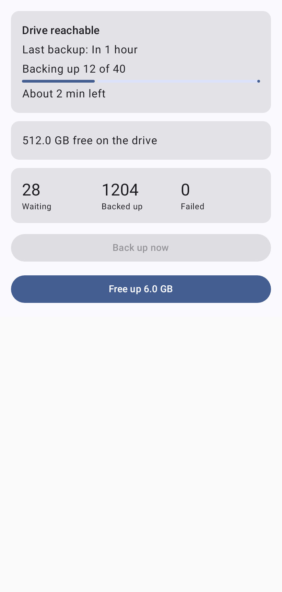

<p align="center">
  
</p>

<h1 align="center">Hearthhold</h1>

<p align="center">
  Back up your phone's photos and videos to the drive plugged into your home router.<br>
  No cloud, no accounts: your pictures stay in your house.
</p>

<p align="center">
  <a href="../../releases/latest"></a>
  
  
</p>

<p align="center">
  
  
  
</p>
<p align="center"><sub>Screenshots use made-up demo data.</sub></p>

## Features

- **Automatic backup** of Camera, Screenshots and any folders you pick, over SMB2/3 on home Wi-Fi.
- **Verified copies**: every file is read back and checked with SHA-256 before it counts as backed up. Nothing on the drive is ever overwritten.
- **Free up space**: suggests old, big items; re-checks both copies by hash, then Android asks you to confirm the delete.
- **Gallery** of phone and drive together, with a badge on each item showing where it lives.
- **Viewer and player** for photos and videos, from the phone or straight from the drive, with loop and 0.25x–2x speed.
- **Gentle on your router**: one file at a time by default, adjustable parallel uploads, optional overnight-only window.
- **Organised drive**: `Device/Source folder/Year/`, with file dates set to when the photo was taken.
- **Named folders**: send a phone folder, or hand-picked items in the Gallery, to a drive folder you name; files already on the drive move there on the next run (never overwritten).

## Install

- Download the APK from the [latest release](../../releases/latest) on your phone and open it (allow installs from your browser).
- Or with USB debugging on: `adb install app/build/outputs/apk/release/app-release.apk`
- Or copy the APK to the phone and open it (allow "install unknown apps" for your file manager).
- Unsigned builds (`app-release-unsigned.apk`) must be signed before installing; see Build.

## Router setup

- Plug the USB drive into the router.
- Enable the router's USB/Samba share and make sure **SMB2 (or SMB3) is enabled**. SMB1 only is not supported.
- Note the share name; the drive is reached at the router's share (e.g. `\\router\share`).

## First run

- Discovery lists the router (or enter its address manually), then pick the share.
- Log in as guest or with credentials.
- Choose or create the destination folder on the drive.
- Grant photo/video and notification permissions. Choose "Allow all": with "Select photos" only some photos can be backed up, and the app says so.
- Camera and Screenshots are backed up by default; other phone folders can be added later in Settings.

## How backups behave

- Runs on home Wi-Fi only, never on mobile data.
- Gentle pacing so the router and phone are not overloaded.
- Parallel setting: number of simultaneous uploads (lower is gentler).
- Overnight window: optionally restrict backups to set hours.
- Notifications show progress and problems.
- Interrupted copies restart from the beginning on the next run; the app cleans up its own `.part` files.
- **Free up space**: removes only items you choose, after a full hash re-check against the drive copy and Android's own confirmation prompt.
- Removed videos play from the drive, with loop and 0.25x–2x speed.

## Gallery icons

Each thumbnail can carry a small round badge in its corner:

| Badge | Meaning |
|---|---|
| Green ✓ (checkmark) | **Backed up**: on the phone *and* on the drive, verified by hash. Safe to free up. |
| Blue ☁ (cloud) | **On the drive only**: no longer on the phone (freed up, or never on this phone). Plays from the drive. |
| Red ! | **Backup failed**: tap it to see why. It retries on the next run. |
| No badge | **Not backed up yet**: on the phone, waiting or uploading. |

The chip at the top shows overall status, e.g. "Backing up 3 of 40", "5 waiting", "2 failed", "Drive not reachable", "Re-enter drive password", "Waiting for overnight window" or "Up to date". Tap it for details and drive free space.

## Drive layout

`<dest>/<device>/<source>/YYYY/`

With named folders: `<dest>\<device>\<folder or source>\YYYY\`.

## Known limits

- FAT32 drives cannot hold files over 4 GB; use exFAT/NTFS/ext4.
- The first backup can take a long time.

## Build

- JDK 17. `./gradlew assembleRelease`
- Signing: create `keystore.properties` in the repo root (gitignored, as are `*.jks` and `*.keystore`):

```
storeFile=C:/path/to/your-release.jks
storePassword=CHANGE_ME
keyAlias=your-alias
keyPassword=CHANGE_ME
```

- With this file present the output is `app/build/outputs/apk/release/app-release.apk`; without it, `app-release-unsigned.apk`. If the file exists but one of the four keys is missing or empty, release builds stop with a message naming the missing key.
- Release builds use R8 shrinking; keep rules are in `app/proguard-rules.pro`.
- README screenshots are rendered from the real screens with demo data: `./gradlew testDebugUnitTest --tests "*ReadmeScreenshots*" -PscreenshotsDir=docs/screenshots`
- Before each release, raise `versionCode` (and `versionName`) in `app/build.gradle.kts`, or phones won't install the update.

## Device test checklist

| # | Check | Result |
|---|-------|--------|
| 1 | Discovery lists the router | |
| 2 | Guest or credential login works | |
| 3 | Choosing and creating a folder works | |
| 4 | A new photo backs up within minutes on home Wi-Fi | |
| 5 | It doesn't back up on mobile data | |
| 6 | Turning Wi-Fi off mid-video, then back on, completes cleanly with no `.part` left | |
| 7 | Free-up removes only the chosen items after Android's prompt | |
| 8 | A removed video plays from the drive with loop and 2x speed working | |
| 9 | Revoking photo permission makes the status show "Photos permission needed" | |
| 10 | The status sheet shows the drive's free space (not 0) | |
| 11 | A folder rule answered Yes moves the already-backed-up files into the named folder | |
| 12 | A folder rule answered No leaves the old files where they are; new ones go to the named folder | |
| 13 | Hand-picking a drive-only item in the Gallery and choosing a folder moves it | |
| 14 | A move started with Wi-Fi turned off waits, and the next run on Wi-Fi completes it | |
